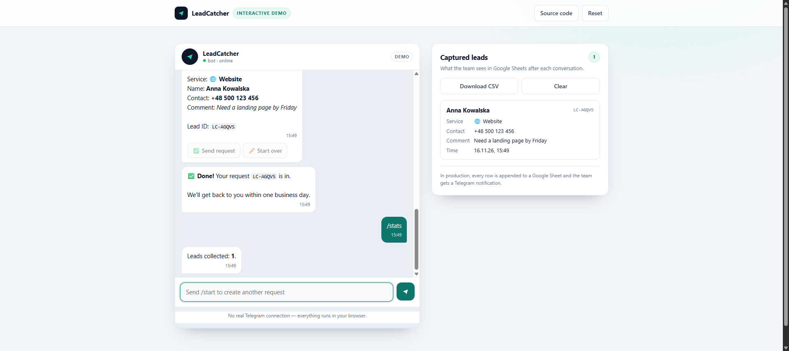

# LeadCatcher — Telegram lead bot

A Telegram bot that collects requests from clients and stores them in Google Sheets.
Includes an interactive browser demo of the same conversation flow.

**Live demo:** https://psh0lnhy.github.io/telegram-lead-bot/
**Repository:** https://github.com/psh0lnhy/telegram-lead-bot



---

## What it does

1. Client sends `/start`.
2. Bot asks four short questions: service, name, contact, comment.
3. Client confirms the summary — one tap.
4. The lead is appended to a Google Sheet and the team gets a Telegram notification.
5. The client receives a confirmation with a lead ID.

Everything runs without a server framework: Node.js 18+, built-in `fetch`, no npm dependencies.

## Flow

```
/start
  └─ Choose service   [Website] [Telegram bot] [Automation] [Other]
      └─ Name
          └─ Phone or @username
              └─ Comment  (or Skip)
                  └─ Summary → [Send request] [Start over]
                      └─ ✅ Saved to Google Sheets + team notification
```

## Stack

| Part | Technology |
|---|---|
| Bot runtime | Node.js 18+ (zero dependencies) |
| Telegram | Bot API long polling, inline keyboards, callback queries |
| Storage | Google Sheets via Apps Script web app (or local `leads.jsonl` fallback) |
| Demo | Static HTML/CSS/JS, no build step |

## Project structure

```
bot.js                  bot logic: conversation state, validation, storage
google-apps-script.js   Apps Script backend that appends rows to a Sheet
docs/index.html         interactive demo for the browser (GitHub Pages)
.env.example            configuration template
```

## Setup

### 1. Create the bot

1. Open [@BotFather](https://t.me/BotFather) in Telegram → `/newbot` → copy the token.
2. Send your new bot any message, then open
   `https://api.telegram.org/bot<TOKEN>/getUpdates` to find your `chat.id` (for `ADMIN_CHAT_ID`).

### 2. Configure and run

```bash
cp .env.example .env      # paste BOT_TOKEN and ADMIN_CHAT_ID
npm start                 # or: node bot.js
```

Without Google Sheets configured, leads are saved to `leads.jsonl` — handy for local testing.

### 3. Connect Google Sheets (optional, ~5 minutes)

1. Create a Google Sheet → **Extensions → Apps Script**.
2. Paste `google-apps-script.js`, run `setup()` once, allow access.
3. **Project settings → Script properties** → add `TOKEN = <random string>`.
4. **Deploy → New deployment → Web app**:
   - Execute as: **Me**
   - Who has access: **Anyone**
5. Copy the `/exec` URL into `SHEETS_WEBHOOK_URL` and the same secret into `SHEETS_TOKEN`.

### 4. Deploy the bot

Any host that runs Node.js works: Railway, Render, a €4 VPS, Fly.io.
Set the environment variables from `.env` and run `npm start` under a process manager
(`systemd`, `pm2`) or as a worker process.

> Long polling needs no public URL or HTTPS certificate, so a minimal VPS is enough.

## Design decisions

- **Inline keyboards instead of free text** for the service choice: fewer wrong answers,
  and the client sees the options immediately.
- **Validation before saving** (name, phone/username) — bad leads cost more time than missing ones.
- **Confirmation step** — the user reviews a summary before anything is written.
- **Storage abstraction** — Sheets when configured, a local JSONL file otherwise,
  so the bot can be tested without external accounts.
- **No framework** — the whole bot is one readable file, easy to audit and host anywhere.

## What I'd add next

- Rate limiting per user (anti-spam)
- Webhook mode for high load
- Google Sheets ↔ CRM sync (HubSpot, Pipedrive)
- `/export` command for the admin

## Case study (for the portfolio)

**Project:** Telegram lead-collection bot
**Role:** Design, bot logic, Google Sheets integration, demo page
**Stack:** Node.js, Telegram Bot API, Google Apps Script, vanilla JS

### The task

A small service business was losing inbound requests: people wrote on Instagram and Telegram
at random hours, and messages got buried. They wanted one predictable entry point where a
client can leave a request in under a minute, and the team gets it in a single spreadsheet.

### What I built

- A scripted Telegram conversation with inline keyboards (service → name → contact → comment)
- Server-side validation of phone numbers and @usernames
- A confirmation screen with a lead ID before writing anything
- Google Sheets storage through an Apps Script webhook, with a local file fallback
- Instant Telegram notification to the team for every new lead
- An interactive browser demo of the same flow, so the client can try it without installing anything

### Result

The client gets structured leads instead of unstructured chat messages, and the team
answers within one business day instead of "whenever someone scrolls the chat".

> The demo runs entirely in the browser: no data is sent anywhere, leads are stored in
> `localStorage` and can be exported as CSV.
